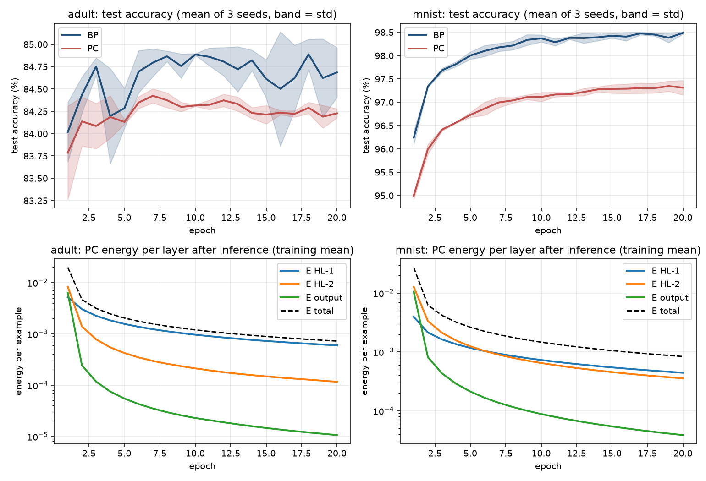
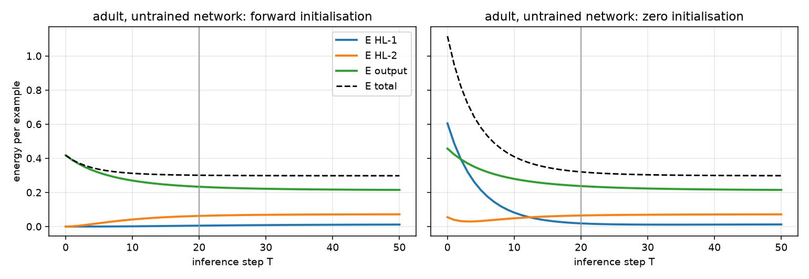
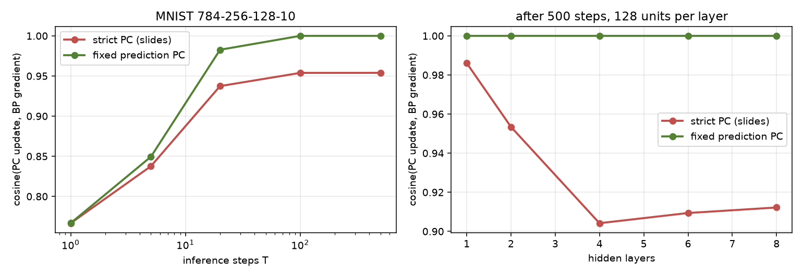

# Backpropagation vs predictive coding, in PyTorch

I implemented a standard neural network trained with backpropagation (BP) and a predictive coding (PC)
network, both in PyTorch, following the formulation of the "BackProp vs Predictive Coding" slides. Both
learners use **the same data, architecture, initial weights, mini-batches, optimiser, learning rate and
number of epochs**, so the only thing that differs is how credit is assigned.

| task requirement | where |
|---|---|
| standard network trained with backpropagation | `models.py`, `BPNet` |
| PC: layer-wise prediction errors `ε(l) = z(l) − μ(l)` | `PCNet.errors` |
| PC: layer-wise energy `E(l) = ½‖ε(l)‖²` | `PCNet.errors`, printed every epoch by `compare.py` |
| PC: latent state updates | `PCNet.infer` |
| PC: total energy `E_total = Σ E(l)` | `PCNet.train_step`, `study_inference.py` |
| comparative analysis | `compare.py`, `tune.py`, `results/` |
| limitations of BP addressed by PC | [below](#which-limitations-of-backprop-does-pc-address) |
| what changed in PyTorch for PC, and why PyTorch cannot do full PC | [below](#what-i-changed-in-pytorch-for-pc) |

And the points raised in the training session:

| point | where |
|---|---|
| nominal vs ordinal classification | [decisions](#why-i-made-each-decision): nominal features and targets one-hot, the ordinal feature as a rank |
| neuron counts as powers of 2 | hidden layers 64 / 32 and 256 / 128, batch size 64 |
| inference has to be fast | prediction is one forward pass for both (same time, [results](#results)); PC's own inference starts from a forward pass so it settles faster |
| justify every decision | [decisions](#why-i-made-each-decision), each backed by a measurement where possible |
| same shared settings for BP and PC | `config.py`; one set of layers, initial weights, batches, optimiser and learning rate |
| PyTorch for both | `models.py` |

## The formulation (from the slides)

Each node `l` holds a latent state `z(l)`; `z(0) = x` is the input and, during training, the output node is
clamped to the target, `z(L) = y`.

```
S(l)   = W(l) z(l-1) + b(l)               weighted sum entering node l
μ(l)   = A(S(l))                          prediction (projection), A = ReLU for hidden nodes, linear at the output
ε(l)   = z(l) − μ(l)                      prediction error
E(l)   = ½ ‖ε(l)‖²                        energy of node l
E_total = Σ_l E(l)

inference, T steps, weights fixed:
z(l) ← z(l) − η ( ∂E(l)/∂z(l) + ∂E(l+1)/∂z(l) )
     = z(l) − η ( ε(l) − W(l+1)ᵀ [ε(l+1) ⊙ A′(S(l+1))] )

learning, states fixed:
W(l) ← W(l) − α ∂E(l)/∂W(l),   ∂E(l)/∂W(l) = −[ε(l) ⊙ A′(S(l))] z(l−1)ᵀ
```

One addition to the slides: each hidden node's step is capped, `η(l) = min(0.1, 1 / (1 + ‖W(l+1)‖²))`. The
state update is gradient descent on the energy, and it only settles while `η × (1 + ‖W(l+1)‖²)` stays below
about 2. In my first full run the weights grew during training and one of six runs crossed that limit at
epoch 18 (Adult, seed 2): the energy went up at 19 of the 20 inference steps, the update stopped following
the gradient and accuracy fell. With the cap that run stays stable. At the start of training, and in the
slides' example, the cap is above 0.1, so nothing changes there.

As in the slides, the states start from a forward pass (`z = μ`, so at step 0 only the output has an
error), all hidden nodes update at once from the errors at the start of the step, and the predictions are
recomputed from the new states at every step. Testing is one forward pass, exactly as for BP.

`slide_example.py` runs the worked example of the slides through these same classes and reproduces its
numbers (forward pass 0.2283, loss 0.2977, `dW = −0.1208`, `W_new = 0.50121`, PC states 0.1945 and 0.1385
after one step, `ε = 0.7335`, `E_HL2 = 0.0015` after two). Some values differ in the third or fourth
decimal because the slides round in the middle of the calculation: they continue with 0.156 instead of
0.1566, so they get 0.1945 where the exact value is 0.1952.

Two small things I noticed in the slides while doing this: on the BP forward-pass slide `1 × 0.33` is
written as `0.033` (so `Z` should be 0.73, not 0.433); and the architecture slide writes the energy as
`E = (ε(1))ᵀ·ε(2)`, while the worked example uses `E(l) = ½ ε(l)ᵀε(l)` for each node and sums them. I
follow the worked example.

## Results

Same settings for both learners, 20 epochs, seeds 0, 1 and 2, mean (standard deviation). From
`python compare.py` (output in `results/compare_output.txt`).

**Adult** (91 → 64 → 32 → 2, learning rate 0.2, 29,305 training and 16,281 test examples)

| | BP | PC |
|---|---|---|
| test accuracy | 84.69% (0.28) | 84.23% (0.05) |
| balanced accuracy (mean of the two class recalls) | 75.55% (2.86) | 74.92% (1.32) |
| training time per epoch | 0.30 s | 2.81 s |
| predicting the whole test set | 3.27 ms | 3.32 ms |
| learned parameters | 8,034 | 8,034 |
| latent states per example (hidden + output) | 0 | 96 + 2 |
| multiply-adds per training example | 17,984 | 224,768 |
| PC energy after inference, last epoch | | HL-1 0.0006, HL-2 0.0001, output 0.0000, total 0.0007 |
| cosine(PC update, BP gradient), last epoch | | 0.981 |

**MNIST** (784 → 256 → 128 → 10, learning rate 0.5, 54,000 training and 10,000 test examples)

| | BP | PC |
|---|---|---|
| test accuracy | 98.49% (0.03) | 97.31% (0.16) |
| training time per epoch | 1.07 s | 12.56 s |
| predicting the whole test set | 27.59 ms | 28.21 ms |
| learned parameters | 235,146 | 235,146 |
| latent states per example (hidden + output) | 0 | 384 + 10 |
| multiply-adds per training example | 503,552 | 6,080,256 |
| PC energy after inference, last epoch | | HL-1 0.0004, HL-2 0.0004, output 0.0000, total 0.0008 |
| cosine(PC update, BP gradient), last epoch | | 0.933 |



What I read from this:

- **Accuracy.** With identical settings and only local updates, PC ends 0.5 points behind BP on Adult and
  1.2 points behind on MNIST. On Adult it is also the steadier of the two across seeds (0.05 vs 0.28).
- **Prediction is equally fast.** Both learners predict with one forward pass through the same layers,
  so the time is the same (3.3 ms vs 3.3 ms, 27.6 ms vs 28.2 ms). All of PC's extra cost is in training.
- **Training is about 10× slower** (9.4× on Adult, 11.7× on MNIST), which matches the count of
  multiply-adds (12.5× and 12.1×): every update first runs T = 20 inference steps.
- **The same learned parameters**, plus latent states: one per hidden neuron (96 and 384 per example),
  and one per output neuron, which is clamped to the target during training (2 and 10). They are not
  learned; they are reset for every example. The slides count them the same way for their 6-4-2-1
  network, with one inconsistency: the text says "latent states = 4 + 2 = 6" (hidden only), but the total
  "34 + 7 + 7 = 48" adds 7, which also counts the output node. Strictly, only the 41 weights and biases are
  parameters; the states are activity.
- **Layer-wise energy.** Every node's energy falls during training. After inference almost none of it is
  left at the output: inference spreads the output error over the hidden nodes, and each layer's weight
  update then uses its own share of it.
- **PC follows the gradient.** Its weight update points in nearly the same direction as backprop's
  (cosine 0.98 and 0.93), without ever computing it.

Choosing the learning rate (`python tune.py`, validation accuracy after 5 epochs):

| learning rate | Adult BP | Adult PC | MNIST BP | MNIST PC |
|---|---|---|---|---|
| 0.01 | 81.27 | 80.07 | 90.95 | 88.68 |
| 0.05 | 84.00 | 82.62 | 95.43 | 93.78 |
| 0.1 | 84.00 | 83.23 | 96.62 | 95.02 |
| **0.2** | **84.03** | 83.81 | 97.27 | 95.77 |
| **0.5** | 83.78 | 83.91 | **97.63** | 96.33 |
| 1.0 | 83.60 | 83.63 | 97.60 | 96.65 |

Bold: the value both learners use, BP's best (Adult 0.2, MNIST 0.5).

The inference phase (`python study_inference.py`, Adult, untrained network):



| T | 1 | 2 | 5 | 10 | **20** | 50 |
|---|---|---|---|---|---|---|
| validation accuracy after 2 epochs | 80.41 | 81.63 | 82.68 | 83.20 | **83.66** | 83.69 |
| seconds per epoch | 0.45 | 0.56 | 0.85 | 1.32 | 2.37 | 5.22 |

## Why I made each decision

| decision | choice | why |
|---|---|---|
| datasets | **UCI Adult** (48,842 people, income > 50K) and **MNIST** | Adult is customer data like the loan example in the slides (it even has marital status and sex), with nominal and ordinal columns and a real class imbalance. MNIST is the benchmark most PC papers report, with 10 classes and a larger network. |
| nominal features | one-hot (workclass, marital status, occupation, relationship, race, sex, country) | the categories have no order, so a single number would invent one (e.g. "married = 2 > single = 1"). This is the slides' "categorical to numeric conversion". |
| ordinal feature | education as its rank 0..15, then scaled | education levels do have an order (HS-grad < Bachelors < Masters), and a rank keeps it with one column instead of 16. |
| targets | one-hot, one output neuron per class | both datasets' classes are **nominal** (income bracket labels, digits as symbols). An ordinal target would use a single output or cumulative encoding instead. |
| scaling | min-max to [0, 1], as in the slides; `log(1 + x)` first for capital gain and loss | without the log, capital gain (up to 99,999) would squash almost everyone to 0. |
| dropped columns | `fnlwgt` (a census sampling weight, not a property of the person) and `education_num` (the same information as the education rank) | |
| missing values | `?` becomes its own category, "Unknown" | the rows are kept and the model can learn whether "unknown" matters. |
| layers | 2 hidden layers | the slides' HL-1 and HL-2. Two hidden layers already learn both tasks well, and my alignment study shows that the deeper a PC network is, the further its update moves from the true gradient. |
| widths | 2ⁿ: Adult 91 → 64 → 32 → 2, MNIST 784 → 256 → 128 → 10 | powers of two match how memory and vector units are laid out, so matrix products run efficiently; each layer halves the previous one, compressing step by step. |
| hidden activation | ReLU | as in the slides; cheap, and its derivative is 0 or 1. |
| output activation and loss | linear output, `½‖ŷ − y‖²` for BP | as in the slides. It is exactly PC's output energy `½‖ε‖²`, so both learners minimise the same objective. Cross-entropy would need a non-Gaussian (categorical) energy in PC, a different model. |
| optimiser | plain SGD for both, no momentum | it is the slides' rule `W ← W − α dW` exactly; each learner gets its own `torch.optim.SGD` with the same settings. |
| learning rate | Adult 0.2, MNIST 0.5, the same for both | chosen on a validation split (10% of the training set) as the best value **for BP** in `tune.py`. PC's own best is 0.5 / 1.0 and would add only 0.1 / 0.3 points, so the shared value slightly favours BP. |
| batch size | 64 (2⁶) | small enough for many updates per epoch, large enough to use vectorised matrix products. |
| initial weights | PyTorch's default `nn.Linear` initialisation, one copy for each learner | identical starting points remove one source of difference. |
| epochs and seeds | 20 epochs, seeds 0, 1, 2 | both accuracy curves are nearly flat by epoch 20; three seeds show the spread. |
| PC inference rate η | 0.1, capped at `1 / (1 + ‖W(l+1)‖²)` | 0.1 is the slides' value; `study_inference.py` shows it is stable on the untrained network, while without the cap 1.0 is worse and 2.0 diverges. The cap keeps it stable as the weights grow (see above). |
| PC steps T | 20 | `study_inference.py`: validation accuracy 83.66% at T = 20 vs 83.69% at T = 50, for less than half the time. It also follows the rule of thumb in the FabricPC talk (Behrend, 2026): at least as many steps as layers, typically 5 × depth, here 5 × 3 = 15. |
| PC initialisation | forward pass | as in the slides. At step 0 the energy is only at the output (0.42), against 1.12 when the states start at zero, and it stays lower all the way. |
| PC variant | strict (predictions recomputed every step) | that is what the slides do (their step 2 uses the new μ = 0.2665). |

## What I changed in PyTorch for PC

PyTorch is built around backpropagation: a module's `forward` records a graph, `loss.backward()` sends one
global error back through it, and the optimiser applies `param.grad`. For PC I kept what can be shared and
replaced the rest.

Shared with BP: the `nn.Linear` layers (same weights and biases), the forward pass (used for PC's
initialisation and for testing), `torch.optim.SGD`, and the data and batch order.

Changed for PC, and why:

1. **Autograd is switched off.** The parameters have `requires_grad=False` and inference runs under
   `torch.no_grad()`, so no graph is recorded and no backward pass is possible. PC must not use the global
   chain rule.
2. **The latent states `z(l)` are ordinary tensors kept outside the module.** PyTorch has no notion of a
   neuron state that persists and changes while the weights stay fixed.
3. **There is a second, inner loop.** T inference steps run per batch before every weight update.
4. **The state and weight updates are written out by hand** from the local errors (the slides' formulas).
   The weight gradient is placed in `param.grad`, and the same optimiser as BP applies it.

`tests/test_pc.py` checks this: it replaces `torch.autograd.grad`, `torch.autograd.backward` and
`Tensor.backward` with functions that raise an error, and PC still trains. It also checks that my
hand-written updates equal the gradient of the total energy, and that a layer's weight update does not
change if every other layer's error is replaced by noise.

## Why PyTorch cannot do full PC

1. **Autograd is backpropagation.** It differentiates one scalar through the whole graph with the chain
   rule, from the output back to every weight. That is the global, sequential backward pass PC is meant to
   avoid. I can use it to compute `∂E_total/∂z` (the tests do), and because the energy is a sum of local
   terms the answer is local, but the machine that computes it is still a backward pass.
2. **No latent states.** `nn.Module` stores parameters and computes activations on the fly. PC needs
   neuron states that exist on their own, are changed by an inner optimisation, and reset for each input.
3. **One clock, one layer at a time.** In the brain (or on neuromorphic hardware) every neuron would relax
   at the same time, continuously. PyTorch runs the layers in a Python loop, one after another, in discrete
   steps, so the parallelism that makes PC attractive does not appear. The 20 inference steps become 20
   extra passes over the network, and PC trains about 10× slower than BP here.
4. **Locality is not enforced.** Nothing in PyTorch stops a layer from reading another layer's error; the
   locality of PC is a property of how I wrote the update, which is why I test it.
5. **The optimisers expect one loss.** `torch.optim` steps parameters from `.grad`; there is no optimiser
   for "relax these states for T steps, then update the weights once", so the two-phase loop is written by
   hand.

The FabricPC library (Behrend, 2026) went through the same thing: its first version used PyTorch with explicitly
coded gradients, as here, and the next version moved to JAX with gradients computed separately for each node,
which made it about 2× faster.

## Which limitations of backprop does PC address?

The limitations are the ones listed in the slides; Ororbia and Kifer (2022) give the same list, plus one the slides
leave out: a neuron must know the derivative of its own activation function.

| limitation of BP (slides) | addressed by PC? |
|---|---|
| uses a global error signal | **yes.** Every update uses only `ε(l)`, `ε(l+1)` and neighbouring states; the test above shows a layer's update ignores every other error. |
| separate global feedback pathway that changes weights but not activity | **yes.** In PC the errors change the neuron states themselves during inference, before any weight changes. |
| update locking (a layer waits for the full forward and backward pass) | **partly.** All layers update at the same time from local errors, but they still wait for the T inference steps to finish. |
| needs exact weight symmetry between forward and backward paths | **no.** The state update uses `W(l+1)ᵀ`, the transpose of the forward weights, so the same symmetry is still required. Removing it needs separate, learned feedback ("error") synapses, as in the neural generative coding framework of Ororbia and Kifer (2022). |
| a neuron needs its own activation's derivative (Ororbia and Kifer) | **no.** Both the state update and the weight update use `A′(S)`. |
| biologically implausible | **more plausible.** Local, Hebbian-like updates (error × activity) and error neurons, but still with weight symmetry and many inference steps per example. |

PC also brings a problem BP does not have: its inference is an optimisation of its own, and it can become
unstable. The step that is safe depends on the size of the weights, which keep changing during training
(one of my runs crossed the limit before I added the cap). The FabricPC team reports the same kind of problem
and clips the latent gradients; I cap the step size instead.

And what PC costs: T = 20 inference steps per training example, so many more multiply-adds per update than
BP, and the extra memory for latent states and errors. At test time there is no difference at all, because
both predict with one forward pass.

## Extra: strict PC vs the fixed prediction assumption

The slides' PC recomputes the predictions from the relaxed states at every step ("strict"). Freezing them at
their forward-pass values instead (the Fixed Prediction Assumption, Millidge et al. 2020) changes one thing
in `PCNet.infer`. `study_alignment.py` measures the cosine between the PC weight update and the BP gradient:

| inference steps T | 1 | 5 | 20 | 100 | 500 |
|---|---|---|---|---|---|
| strict (slides) | 0.767 | 0.838 | 0.937 | 0.954 | 0.954 |
| fixed predictions | 0.767 | 0.850 | 0.983 | **1.000** | **1.000** |

| hidden layers (128 each, 500 steps, 3 seeds) | 1 | 2 | 4 | 6 | 8 |
|---|---|---|---|---|---|
| strict (slides) | 0.986 | 0.953 | 0.904 | 0.909 | 0.912 |
| fixed predictions | 1.000 | 1.000 | 1.000 | 1.000 | 1.000 |

With fixed predictions PC computes **exactly** the backprop gradient (cosine 1.0000) from local signals.
Strict PC converges to a different point, about 0.95 for the network used here and about 0.91 for deeper
ones. So the slides' PC approximates backprop closely but not exactly, and the gap comes from the
predictions moving during inference.



## How to run

```bash
python -m venv ../.venv && source ../.venv/bin/activate
pip install -r requirements.txt --extra-index-url https://download.pytorch.org/whl/cpu
python slide_example.py        # the slides' worked example (seconds)
python -m pytest               # 13 checks (seconds)
python compare.py              # BP vs PC on Adult and MNIST (reloads saved runs; --retrain about 20 min)
python tune.py                 # learning-rate choice on the validation split (about 10 min)
python study_inference.py      # energy during inference, eta and T (about 1 min)
python study_alignment.py      # strict vs fixed prediction PC (about 3 min)
python make_figures.py         # redraws results/*.png
```

The datasets download into `data/` the first time.

## References

- The training slides, "BackProp Vs Predictive Coding" (iCog Labs).
- M. Behrend, *FabricPC: Predictive Coding Library for Scalable Research*, ActPC team, 2026.
- A. Ororbia and D. Kifer, *The neural coding framework for learning generative models*, Nature Communications 13, 2064 (2022).
- B. Millidge, A. Tschantz and C. L. Buckley, *Predictive Coding Approximates Backprop along Arbitrary Computation Graphs*, 2020 (the fixed-prediction assumption).

## Files

| file | what it contains |
|---|---|
| `models.py` | `BPNet` and `PCNet`, sharing the same `nn.Linear` layers |
| `data.py` | Adult (one-hot, ordinal rank, min-max) and MNIST, with a validation split |
| `config.py` | every setting, shared ones together |
| `compare.py` | the comparison: accuracy, energy, time, parameters, cost |
| `tune.py` | the learning-rate grid for both learners |
| `study_inference.py` | energy per layer during inference, η and T |
| `study_alignment.py` | PC update vs backprop gradient, strict vs fixed |
| `slide_example.py` | the slides' worked example |
| `make_figures.py` | the figures in `results/` |
| `tests/test_pc.py` | the slides' numbers, autograd switched off, locality, energy gradients |
